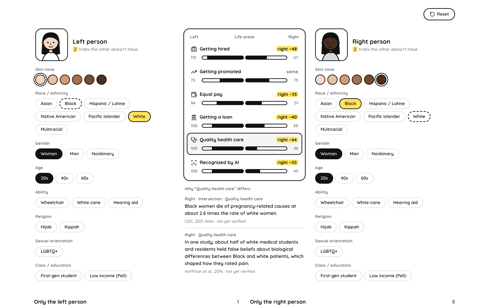

# Same But Different

This is an interactive website for CSE 194/291A (Race, Gender & Computing, UC San Diego, Fall 2026). Team Coffee makes it.

You make two people. The two people are the same, but one or two traits are different. Traits are race, gender, age, disability, religion, sexual orientation, class and skin tone. The site compares some areas of life for the two people: jobs, pay, loans, health care and AI recognition. Each difference has a fact about a group and a source for that fact. Some groups have no data. The site shows these gaps, because a gap is also a result.

**Status:** research. The site code is not in this repository yet.

## Prototype
Open the prototype here: https://same-but-different-prototype.vercel.app

The facts in the prototype are placeholders. The team must verify each fact and put it in `data/facts.csv`.

## Files
| Path | Contents |
|---|---|
| `docs/prototype.png` | A screenshot of the prototype. |
| `data/facts.csv` | The fact database. `data/README.md` gives the format. |
| `research/data-sources.md` | Possible sources for each area of life, UCSD data access, data gaps, and a check of the placeholder facts. |
| `ai-chats/` | Copies of the conversations with AI tools. The final submission must include them. |

## Team
Liza Babior · Nicholas Adams · Christine Manoukian · Anthony Huynh · Macylene De Leon

## Maintenance
Last update: 2026-10-22. Maintenance plan: not decided. Contact: not decided.

## AI use
The team uses AI tools (Claude) for help with the prototype, research and code. The `ai-chats/` folder has copies of all conversations.
