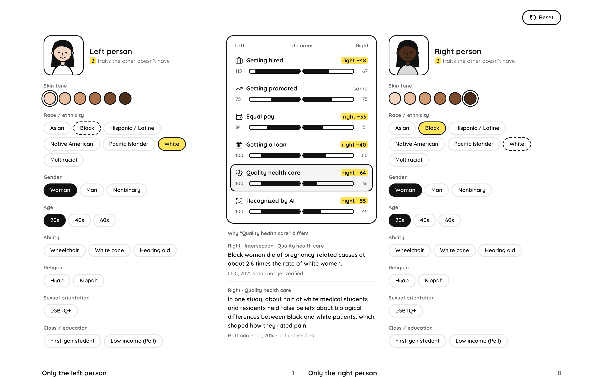

# Same But Different

This is an interactive website for CSE 194/291A (Race, Gender & Computing, UC San Diego, Fall 2026). Team Coffee makes it.

You make two people. The two people are the same, but one or two traits are different. Traits are race, gender, age, disability, religion, sexual orientation, class and skin tone. The site compares some areas of life for the two people: college, jobs, pay, loans, health care and AI recognition. Each difference has a fact about a group and a source for that fact. Some groups have no data. The site shows these gaps, because a gap is also a result.

**Status:** in development. The site shows **mock facts** (invented numbers). The fact team will replace them with verified facts in `data/facts.csv`.

## How to run the site
You need [Bun](https://bun.sh) (`curl -fsSL https://bun.sh/install | bash`) or Node.js 22.

| Task | Bun | npm |
|---|---|---|
| Install | `bun install` | `npm install` |
| Start a local server (http://localhost:4321) | `bun run dev` | `npm run dev` |
| Run the tests | `bun run test` | `npm test` |
| Check the types | `bun run check` | `npm run check` |
| Build the site (also checks the facts) | `bun run build` | `npm run build` |

Live site: https://same-but-different.vercel.app. Each push to `main` deploys the site. If the build fails, the last good version stays online.

## Where to work
| You work on | Files |
|---|---|
| Facts | `data/facts.csv`. `data/README.md` gives the columns and the trait tags. |
| Text pages | `src/pages/about.md`, `src/pages/method.md`. Write Markdown. |
| Sources and Gaps pages | `src/pages/sources.astro`, `src/pages/gaps.astro`. The fact file makes the lists. |
| The Explore page | `src/components/` (React) |
| The comparison rule (scoring) | `src/lib/compare.ts` only |
| Traits and life areas | `src/lib/traits.ts` only |
| Colors, font, spacing | `src/styles/tokens.css` |
| Fact checks and file formats | `src/data/` |

## Prototype
This screenshot shows the first prototype. The prototype is not online. The live site above replaces it.

## Other files
| Path | Contents |
|---|---|
| `docs/specs/codebase-setup.md` | The specification for this codebase. |
| `research/data-sources.md` | Possible sources for each area of life, UCSD data access, data gaps, and a check of the prototype facts. |
| `ai-chats/` | Copies of the conversations with AI tools. The final submission must include them. |

## Team
Liza Babior · Nicholas Adams · Christine Manoukian · Anthony Huynh · Macylene De Leon

## Maintenance
Last update: 2026-11-02. Maintenance plan: not decided. Contact: not decided.

## License
Code: MIT (`LICENSE`). Fact data and site text: CC BY 4.0 (`LICENSE-DATA.md`).

## AI use
The team uses AI tools (Claude) for help with the prototype, research and code. The `ai-chats/` folder has copies of all conversations.
